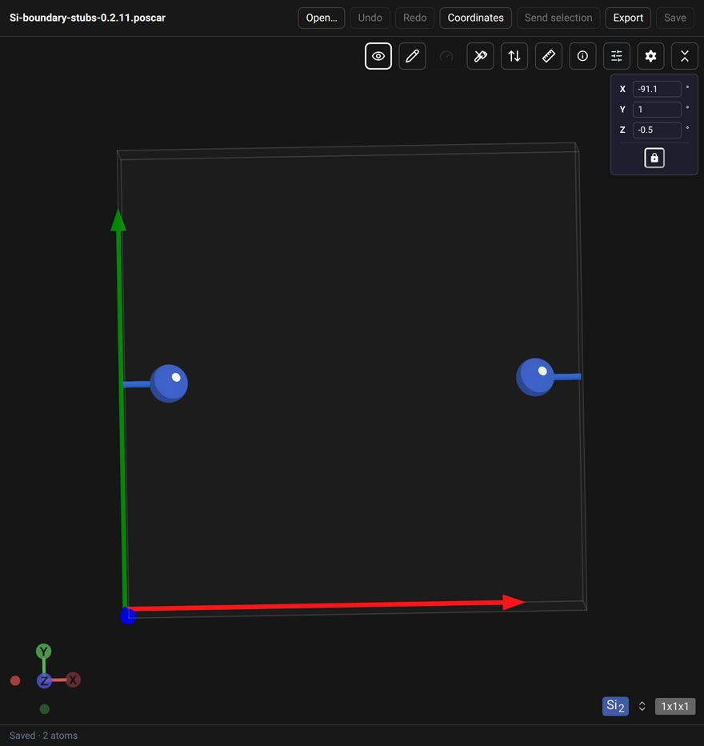
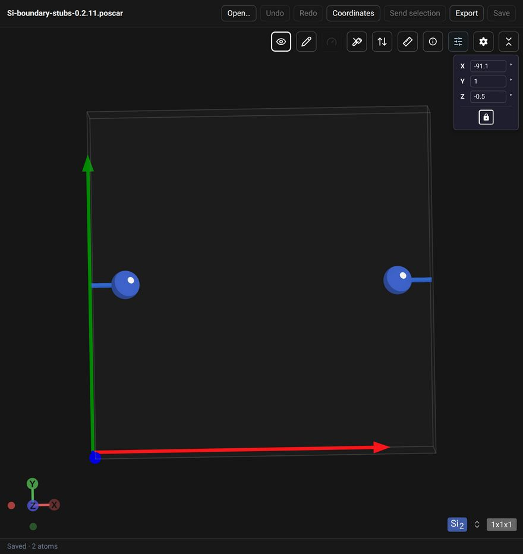
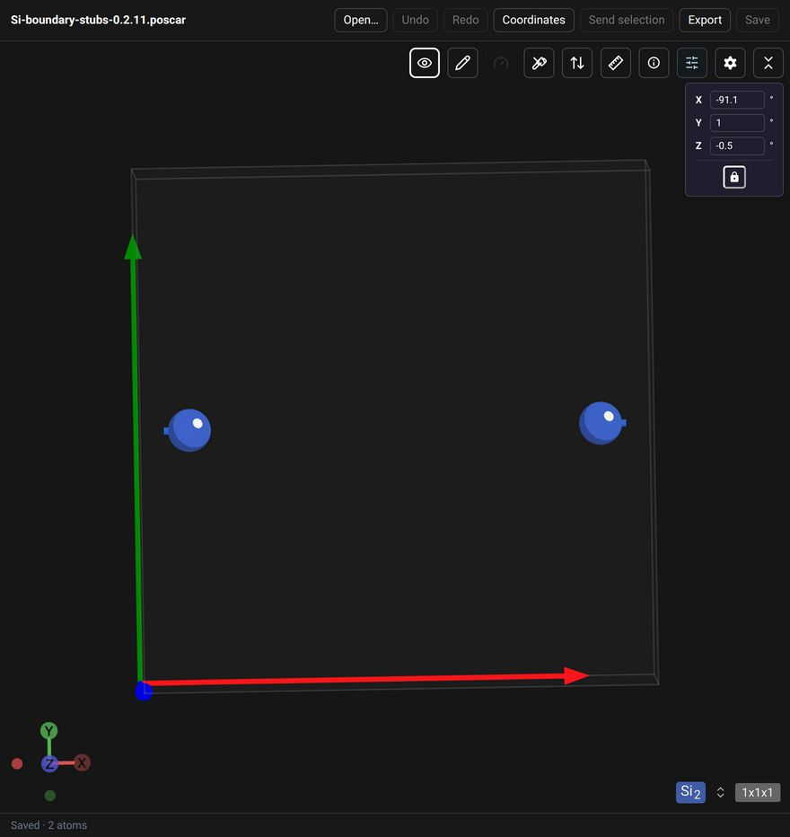

# Native Codex acceptance: 0.2.11

The CatGo 0.2.11 file editor passed the following visual checks in the actual
Codex right panel on Linux on 2026-10-21 (Codex desktop 26.1016.51333).
These screenshots are native-host evidence, separate from the automated
browser protocol harness.

## Results

| Check | Result |
| --- | --- |
| Native file read and two-Si rendering | Passed; the footer displayed `Saved · 2 atoms` and a real canvas showed the atoms. |
| Stub Length 1.0 → 0.5 | Passed; both visible boundary bond segments shortened. |
| Cell-edge stub bonds unchecked | Passed; complete half-bonds appeared. In this fixture they matched the checked 1.0 rendering. |
| Stub mode rechecked at 0.5 | Passed; the 0.5 rendering returned exactly. |
| Private 157-atom structure | Passed; visible native rendering, a `Saved · 157 atoms` footer and no error alerts. |
| Original/copy integrity in the rendering run | Passed; the private structure's original and copies matched their initial SHA256. No coordinate edits or Save actions were performed in that run. |
| Coordinate editing on a new disposable 157-atom copy | Passed in a follow-up run; one atom's Cartesian X coordinate was increased by 0.1 Å. The editor became dirty and enabled Undo and Save; the disk copy remained unchanged before Save. |
| Undo and redo before Save | Passed; Undo restored the initial coordinates and clean state; Redo restored the edit and dirty state. The coordinates panel was reopened after each operation to read the current geometry. |
| Native host-file Save | Passed; Save changed the disposable file on disk and returned to `Saved · 157 atoms`. Independent POSCAR parsing confirmed the intended edit, species/counts, cell and selective-dynamics flags. |
| Reopen saved file | Passed; a newly opened native file tab read back the saved coordinates, showed all 157 atoms, had no error alerts and disabled Save. |
| Protected original after the editing run | Passed; its SHA256 and modification time matched the values recorded before the new copy was created. |

The private structure, its screenshot, local file paths and session identifiers
are not included in this public repository. Its result is a maintainer-reported
check with local evidence. The public screenshots below use only the synthetic
Si fixture. The original rendering receipt and the later
[editing/save receipt](../plugins/catgo-editor/acceptance/native-edit-save-0.2.11.json)
are separate records. Native Windows/macOS rendering, native save-conflict UI,
keyboard shortcuts and undo/redo across a Save were not exercised.

## Native editing and persistence follow-up

The follow-up used the same installed 0.2.11 program and Codex desktop version
on Linux on 2026-10-21. A fresh test copy initially matched the protected original
byte for byte. All edits used **Coordinates → Apply coordinates**, the native
**Undo**/**Redo** buttons and the native **Save** button. No direct file write
was used to simulate a successful editor Save. The test copy retains the test edit.

POSCAR Save normalizes the comment/format and serializes fractional coordinates
to eight decimal places. Comparison therefore used parsed geometry and an
error bound derived from half a unit in the last fractional decimal place and
the cell vectors. The largest Cartesian rounding difference was
0.000000206 Å, within the 0.000000209 Å bound for this cell. Other atoms were
unchanged within that export precision; the cell and all selective-dynamics
flags matched. This is a file-editing check, not a scientific relaxation.

The initial hidden-tab mount retained a `size: 0 × 0` initialization diagnostic
even after the structure became visible at a nonzero canvas size. The side-panel
automation connection later stopped responding after the first successful Save.
Those intermediate records were retained locally. Reopening the saved file in
the active chat restored interaction, showed no alert and read back the disk
coordinates. This does not establish a fix for the hidden-tab startup diagnostic.
No plugin reinstall, host patch or runtime modification was performed.

To reproduce the editing check, use a new disposable copy of a POSCAR, record
its source hash, edit one atom by a known Cartesian displacement, Undo and Redo,
then Save. Independently parse the saved file and reopen it through the native
file entrypoint. Compare geometry at the export precision, species/counts,
cell and constraint flags; verify the protected source's hash and modification
time again. Reopening a file starts a fresh document history.

## Reproduce

1. Open [Si-boundary-stubs-0.2.11.poscar](../examples/Si-boundary-stubs-0.2.11.poscar)
   through the Codex native file entrypoint and select its right-panel file tab.
   The 10 Å cubic cell has two Si atoms at fractional x = 0.1 and 0.9, with
   y = z = 0.5. Their nearest bond crosses the x boundary.
2. Confirm that the actual atoms are visible and the footer reports two atoms.
   A chat tool's "Opened" response or a welcome page is insufficient.
3. Open **Controls → Bonds**. Keep **Bonds = Always**, **Strategy = Atom Radii**
   and **Bond scale = 1.15**. Keep the camera and all other display settings
   unchanged throughout the comparison.
4. With **Cell-edge stub bonds** checked, compare **Stub Length = 1.0** and
   **0.5**. Close the controls pane for unobstructed canvas screenshots. The
   default 0.15 can be hidden inside the atom spheres.
5. At 0.5, uncheck and then recheck **Cell-edge stub bonds**. The unchecked
   state shows complete half-bonds; the checked state restores shorter stubs.
6. Confirm the document remains clean. These are display controls; do not save
   or edit coordinates as part of this visual check.

## Native captures

All four captures below used an 880 × 932 viewport and the same freshly read
camera angles: X = −91.1°, Y = 1°, Z = −0.5°. The image files are unmodified
captures. Pixel comparison used the scene region x = 0–879, y = 230–899,
excluding the toolbar. Length 1.0 versus 0.5 changed 2,547 pixels around the
boundary bonds; rechecking 0.5 restored the scene region with zero changed pixels.
The unchecked state and checked 1.0 state also matched in that region.

| Checked, length 1.0 | Checked, length 0.5 |
| --- | --- |
|  |  |

| Stub mode unchecked | Rechecked, length 0.5 |
| --- | --- |
|  |  |

The [native receipt](../plugins/catgo-editor/acceptance/native-host-0.2.11.json)
records capture hashes and the tested program hash. The earlier
[browser regression receipt](../plugins/catgo-editor/acceptance/boundary-bonds-0.2.11.json)
remains unchanged as a separate historical record. No runtime files, installed
configuration or release version were changed by this acceptance update.
